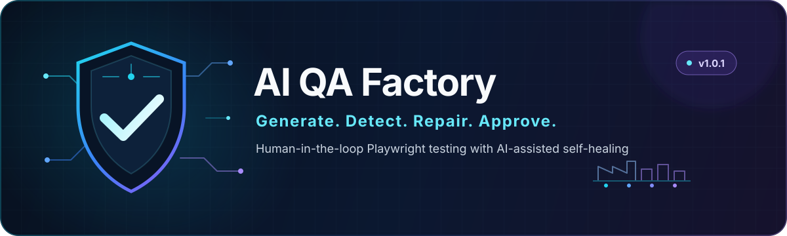

[](https://github.com/MilJav11/ai-qa-factory/actions/workflows/ci.yml)

<p align="center">
  
</p>

<p align="center">A local, human-in-the-loop workspace for generating, diagnosing, and safely repairing Playwright end-to-end tests with AI assistance.</p>

<p align="center">
  <a href="https://github.com/MilJav11/ai-qa-factory/releases/latest"></a>
  
  
  
  
  
</p>

<p align="center">
  <a href="#what-it-does">What it does</a> ·
  <a href="#workflow">Workflow</a> ·
  <a href="#setup">Setup</a> ·
  <a href="#commands">Commands</a> ·
  <a href="#security-and-privacy">Security</a> ·
  <a href="#limitations">Limitations</a> ·
  <a href="https://github.com/MilJav11/ai-qa-factory/releases/tag/v1.0.1">Release notes</a>
</p>

## What it does

- Generates Playwright E2E tests from a URL and scenario description.
- Runs the active Playwright test suite from `tests/`.
- Captures a failure error trace and DOM snapshot when an active test fails.
- Sanitizes the DOM before it is sent to the external AI provider.
- Asks the AI provider for a structured locator-repair suggestion.
- Shows the suggestion to the user; the user must explicitly approve it.
- Validates the target path and locator, writes an approved repair atomically, and allows the test to be run again.

## Workflow

```text
Scenario -> Test Generator -> tests/**/*.spec.ts -> Playwright
                                                |
                                      failure: error trace + DOM
                                                |
                       Guardian -> DOM sanitization -> OpenRouter / DeepSeek
                                                |
                              human approval -> validated atomic test update
                                                |
                                           run test again
```

The Guardian only applies a human-approved repair to an existing `tests/**/*.spec.ts` file.

## Stack

- Python
- Streamlit
- Playwright with TypeScript
- OpenRouter with `deepseek/deepseek-chat` (the model currently configured in the source)
- Python standard-library `html.parser`

## Project layout

- `app.py` — Streamlit UI for the Test Generator and Guardian approval flow.
- `generator_v1.py` — generates Playwright tests through OpenRouter.
- `guardian_v1.py` — sanitizes failure DOM, calls the AI provider, and validates the response schema.
- `guardian_reporter.ts` — stores Playwright failure error output in the Guardian queue.
- `tests/fixtures.ts` — captures a DOM snapshot on test failure.
- `tests/` — active Playwright specs and offline Python tests.
- `playwright.config.ts` — Playwright configuration, including `testDir: './tests'` and the Guardian reporter.
- `qa_standards.txt` — rules supplied to generated tests and repair suggestions.
- `_archive_old_prototypes/` — historical code; do not run it as part of the active workflow.

## Prerequisites

- Python with virtual-environment support
- Node.js and npm
- The project dependencies listed in `requirements.txt` and `package.json`
- An OpenRouter API key for AI generation and Guardian analysis

## Setup

Create and activate a Python virtual environment using the method appropriate for your platform, then install the Python dependencies:

```bash
pip install -r requirements.txt
```

Install the Node.js dependencies and Playwright Chromium browser:

```bash
npm install
npx playwright install chromium
```

Create your local environment file from the safe template. Do not commit the resulting `.env` file.

```bash
cp .env.example .env
```

On PowerShell, the equivalent is:

```powershell
Copy-Item .env.example .env
```

Set `OPENROUTER_API_KEY` in `.env` to your own key.

## Commands

Start the Streamlit UI (this command always starts the UI):

```bash
python -m streamlit run app.py
```

Run the active Playwright tests:

```bash
npx playwright test
```

Run the included SauceDemo spec:

```bash
npx playwright test tests/saucedemo_interview.spec.ts
```

Run the configured Guardian npm script. It runs Playwright first and starts the Streamlit UI only if Playwright exits with a non-zero exit code:

```bash
npm run guardian
```

Run the offline Python unit tests:

```bash
python -m unittest discover -s tests -p "test_*.py" -v
```

## Security and privacy

- `.env` is ignored and must not be committed.
- The Guardian sanitizes and bounds the failure DOM before an external AI request.
- Runtime DOM dumps, error logs, `guardian_queue/`, `test-results/`, and `playwright-report/` are not committed.
- Guardian writes are limited to existing `tests/**/*.spec.ts` files.
- An AI-suggested locator is validated before any change is written.
- Approved changes use an atomic file replacement, so the original test is preserved if writing fails.
- A user must explicitly confirm every repair before it is applied.

## Limitations

- Automatic repair targets supported `page.locator(...)` expressions only.
- `getBy*` locators and complex or nested locator chains are not automatically repaired.
- OpenRouter is an external service; requests to it are subject to its availability and policies.
- Do not use real sensitive production data without conducting your own security assessment.

## Testing and status

Version `1.0.1` documents the current human-approved self-healing workflow and package metadata. The repository includes Playwright specs and offline Python unit tests for Guardian safety, DOM sanitization, and AI error handling. This release-preparation change does not run the application, browsers, network requests, installations, or test suite.

## Roadmap

Possible future work includes CI integration and broader support for Playwright locator forms. These items are not represented as current capabilities.
